

# Sauron

**A modern VPN & proxy client for Windows, macOS and Linux**
**یک کلاینت مدرن VPN و پراکسی برای ویندوز، مک و لینوکس**

[English](#english) · [فارسی](#فارسی)

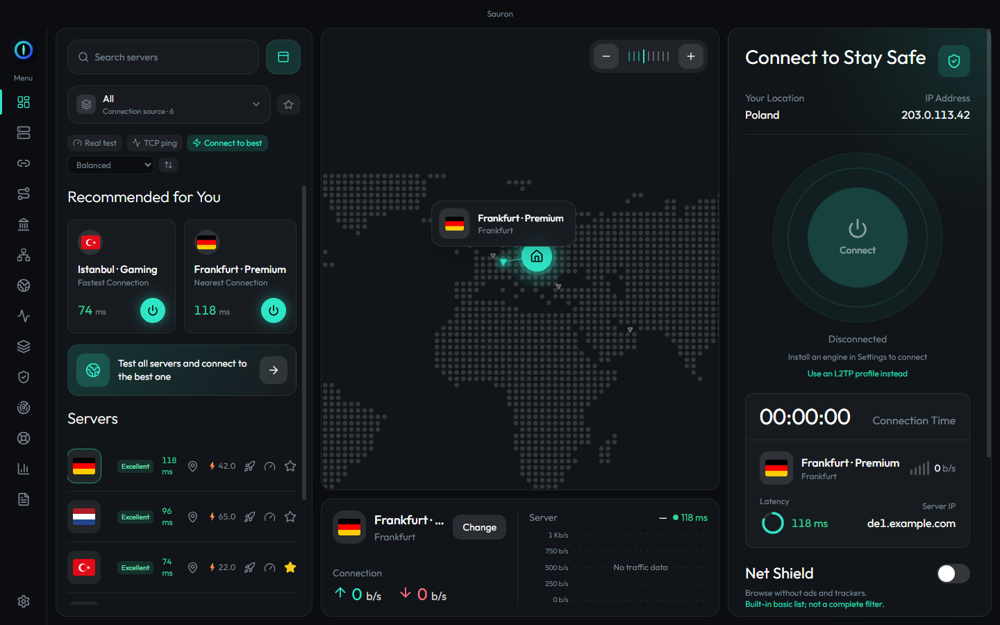

---

## English

Sauron is a desktop client that brings sing-box and Xray, L2TP/IPsec, subscriptions, an interactive world map and leak protection together in one clean interface.

> **Status: alpha (`0.2.0-alpha.17`).** It is under active development. Some parts have not been verified against live servers yet (see [Known limitations](#known-limitations)). Please report problems in the Issues tab.

### Download

Get the latest build from the [**Releases**](../../releases) page.

| Platform | File |
|---|---|
| Windows 10/11 (x64) | `Sauron-Setup-<version>-x64.exe` (installer, no admin rights needed) or the portable `.zip` |
| macOS | not available in this release yet |
| Linux | not available in this release yet |

### Install (Windows)
1. Download `Sauron-Setup-…-x64.exe` from the latest release.
2. Run it and follow the wizard (installs per user, adds Desktop and Start menu shortcuts).
3. Open Sauron, add a server or a subscription link, press the power button.

Windows SmartScreen may warn about an unknown publisher because the app is not code-signed yet: choose **More info → Run anyway**.

### Features
- **Protocols:** VLESS, VMess, Trojan, Shadowsocks, Hysteria2, TUIC (via sing-box / Xray) and **L2TP/IPsec (PSK)** on Windows.
- **Subscriptions:** many subscription links, each with its own tab, auto-update, traffic and expiry info, rename, share (QR/copy), custom icon and color.
- **Server tools:** real delay test, TCP ping, sort, connect to fastest, favorites, country flags.
- **Interactive world map** showing your location, the real exit location (looked up through the tunnel) and a live route with up/down speeds.
- **System proxy or TUN mode**, **kill switch**, **Net Shield** (ad/tracker blocking), DNS manager (DoH/DoT/UDP), IP-leak check.
- **Routing Studio** (rule priority, groups, conflict detection, a match simulator, import / export) and a **domestic-sites bypass** list (e.g. `.ir` always direct) with search, select-all and bulk delete.
- **System tray** with a full right-click menu, launch at login, close-to-tray.
- **Dark / light themes, English and Persian (RTL)**, phone-style layout in narrow windows.
- **Smart server selection:** quality score from real tests (delay, jitter, success rate), optional speed test per server (about 4 MB; optional automatic runs every 12 h while disconnected), modes including High throughput, and Connect to best.
- **Subscription history** with update diff (+ new, − removed, ~ changed) and rollback.
- **Network doctor:** UDP / TLS / IPv6 / DNS-leak checks, Reset network, safe fixes with undo.
- **Connection profiles** (Daily, Gaming, Streaming, Work, Privacy), usage reports, first-run setup wizard, XHTTP via Xray.
- **Sleep / network-change recovery:** the tunnel is checked after waking up or switching Wi-Fi/cable and reconnected to the same server if it died (kill switch stays on).
- **Intelligent failover** (off by default) and a **Routing Studio** with rule priority, groups, conflict detection and a match simulator.
- **Security center** (real protection states, engine integrity and signature checks, IPv6 exposure test, masked diagnostic report you review before sharing), **live connection inspector** and a **network assistant** that answers from real diagnostics.
- **Auto-update** from this repository (installed builds). Versions alpha.8 - alpha.15 could not update themselves: install alpha.17 once by hand.
- Secrets (subscription URLs, L2TP passwords) are encrypted with the OS keystore; logs redact links and credentials.

### Screenshots

| | |
|---|---|
| 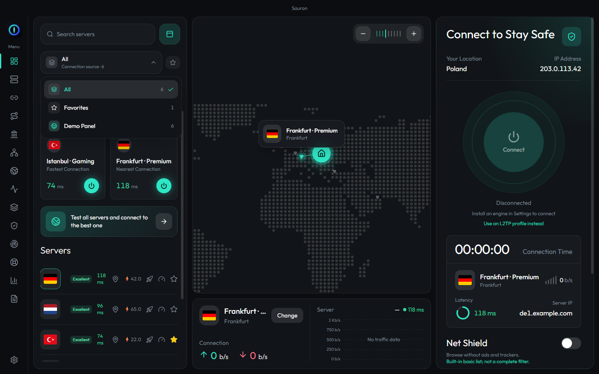 | 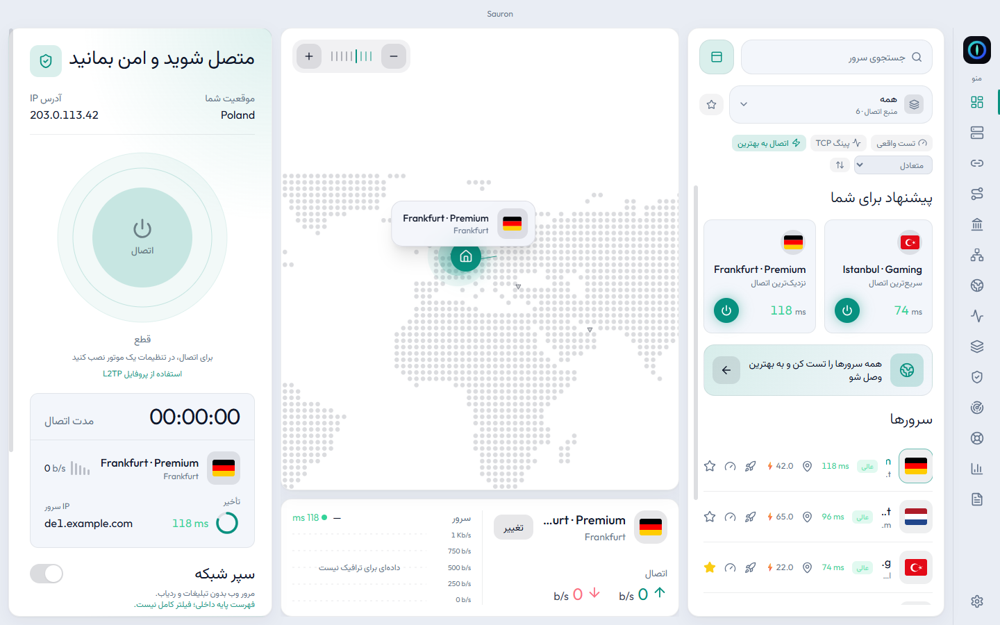 |
| 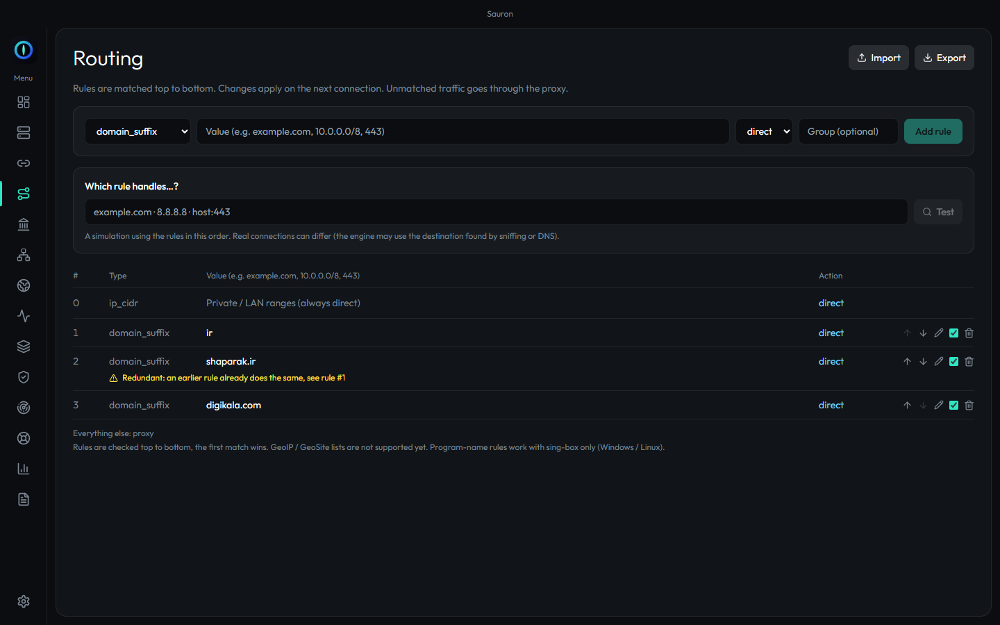 | 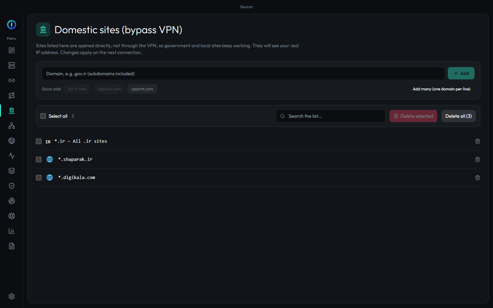 |
| 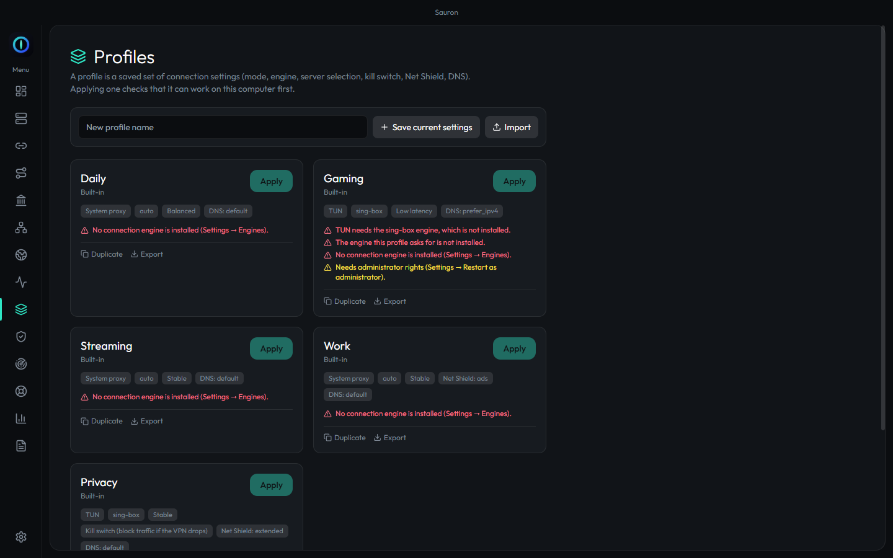 | 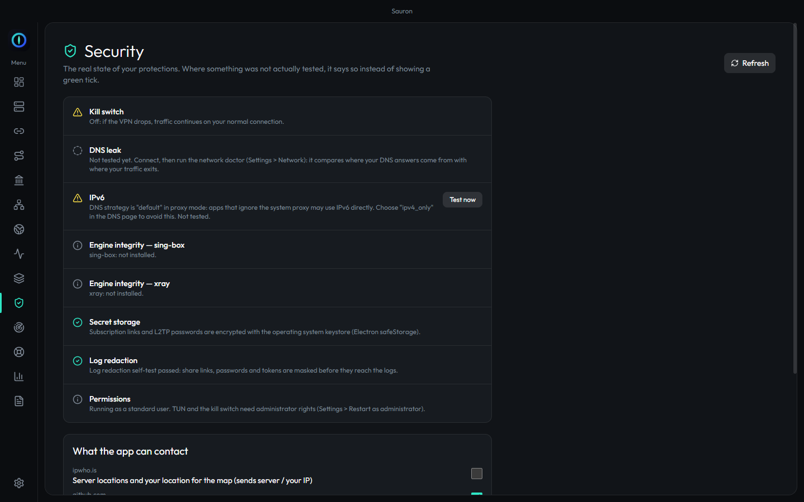 |
| 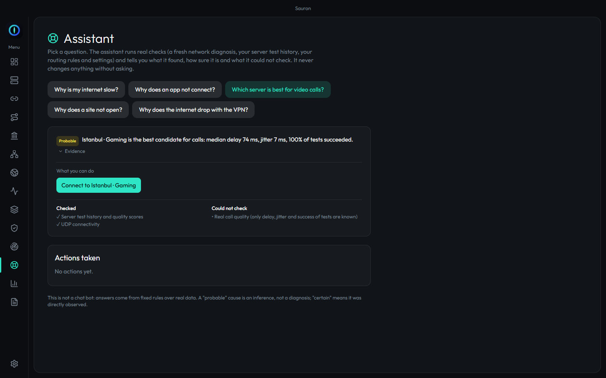 | 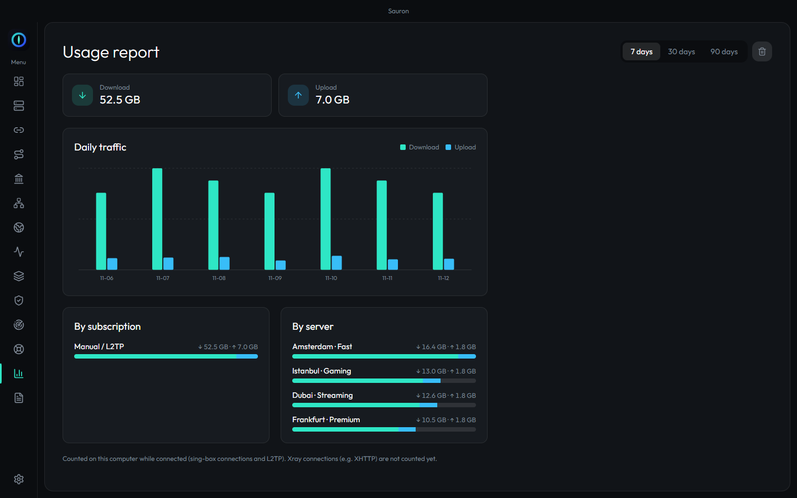 |
| 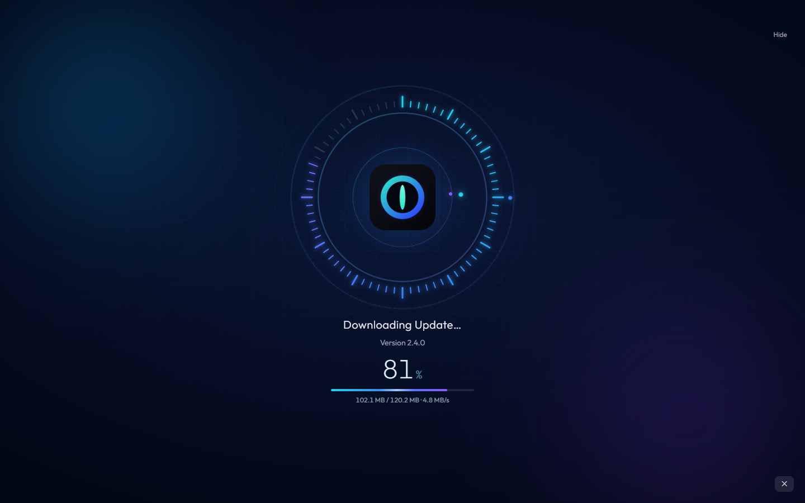 | 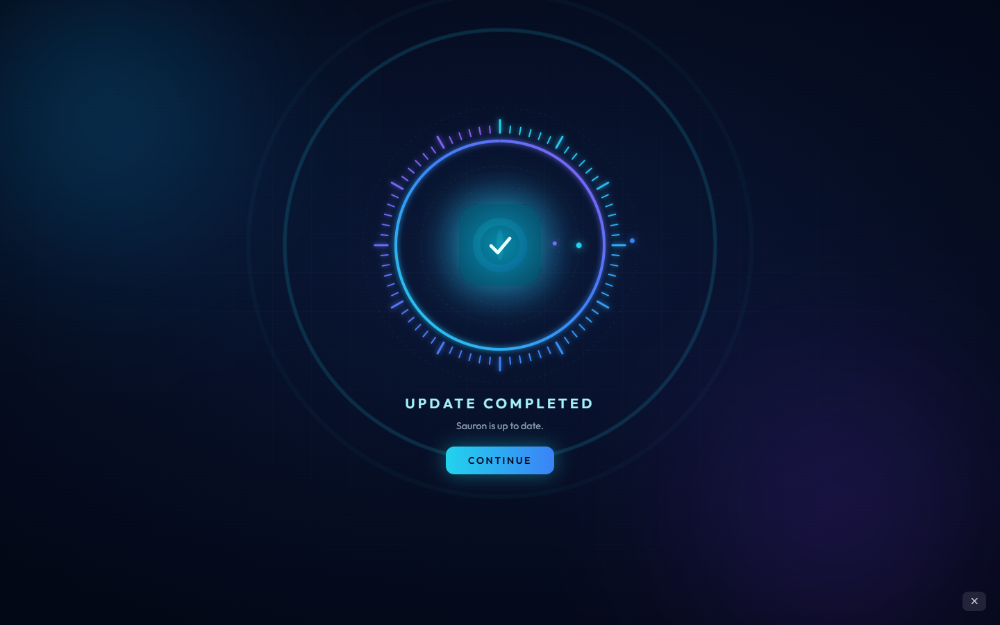 |

Screenshots use sample data only.

### Privacy
- No telemetry or accounts.
- Server locations and your IP/location are looked up through `ipwho.is`; this can be turned off in Settings (the map then shows no locations).
- Sing-box and Xray are third-party engines downloaded on first use from their official GitHub releases (or imported from a local file).

### Known limitations
- Alpha software: end-to-end behavior against real servers, TUN mode, the kill switch (needs Administrator), tray visuals and the auto-update flow have had limited real-world testing.
- L2TP is Windows-only. Kill switch and Net Shield do not apply to L2TP.
- macOS builds are unsigned, so auto-update on macOS is not available yet.
- The source code is not public; this repository only hosts releases.

---

## فارسی

ساوران یک کلاینت دسکتاپ است که sing-box و Xray، L2TP/IPsec، اشتراک‌ها، نقشه تعاملی جهان و محافظت در برابر نشت را در یک رابط ساده و زیبا کنار هم قرار می‌دهد.

> **وضعیت: آلفا (`0.2.0-alpha.17`).** برنامه در حال توسعه فعال است و بعضی بخش‌ها هنوز روی سرورهای واقعی کامل آزمایش نشده‌اند (بخش [محدودیت‌ها](#محدودیت‌ها) را ببینید). مشکلات را در بخش Issues گزارش کنید.

### دانلود

آخرین نسخه را از صفحه [**Releases**](../../releases) دریافت کنید.

| سیستم‌عامل | فایل |
|---|---|
| ویندوز ۱۰/۱۱ (x64) | `Sauron-Setup-<version>-x64.exe` (نصب‌کننده، بدون نیاز به دسترسی ادمین) یا نسخه قابل‌حمل `.zip` |
| مک | هنوز در این نسخه نیست |
| لینوکس | هنوز در این نسخه نیست |

### نصب (ویندوز)
۱. فایل `Sauron-Setup-…-x64.exe` را از آخرین نسخه دانلود کنید.
۲. اجرا کنید و مراحل نصب را دنبال کنید (نصب برای کاربر فعلی، با میانبر دسکتاپ و منوی Start).
۳. برنامه را باز کنید، یک سرور یا لینک اشتراک اضافه کنید و دکمه اتصال را بزنید.

چون برنامه هنوز امضای دیجیتال ندارد، ممکن است SmartScreen هشدار بدهد: **More info ← Run anyway** را بزنید.

### امکانات
- **پروتکل‌ها:** VLESS، VMess، Trojan، Shadowsocks، Hysteria2، TUIC (با sing-box / Xray) و **L2TP/IPsec (با PSK)** در ویندوز.
- **اشتراک‌ها:** چند لینک اشتراک با تب جداگانه، به‌روزرسانی خودکار، نمایش حجم و انقضا، تغییر نام، اشتراک‌گذاری (QR/کپی)، آیکون و رنگ دلخواه.
- **ابزار سرور:** تست تأخیر واقعی، پینگ TCP، مرتب‌سازی، اتصال به سریع‌ترین، علاقه‌مندی‌ها و پرچم کشورها.
- **نقشه تعاملی جهان** با نمایش موقعیت شما، محل واقعی خروج ترافیک (از داخل تونل بررسی می‌شود) و مسیر زنده همراه با سرعت دانلود/آپلود.
- **پروکسی سیستمی یا حالت TUN**، **کیل‌سوییچ**، **Net Shield** (مسدودسازی تبلیغات و ردیاب‌ها)، مدیریت DNS (‏DoH/DoT/UDP) و تست نشت IP.
- **استودیوی مسیریابی** (اولویت قانون، گروه‌بندی، تشخیص تعارض، شبیه‌ساز تطبیق، ورودی/خروجی) و فهرست **عبور مستقیم سایت‌های داخلی** (مثلاً دامنه‌های `.ir` همیشه مستقیم) با جستجو، انتخاب همه و حذف گروهی.
- **آیکون سینی سیستم** با منوی راست‌کلیک کامل، اجرای خودکار با ویندوز و بستن به سینی.
- **تم تیره و روشن، زبان فارسی (راست‌به‌چپ) و انگلیسی**، و چیدمان موبایلی در پنجره‌های باریک.
- **انتخاب هوشمند سرور:** امتیاز کیفیت از تست‌های واقعی (تأخیر، جیتر، نرخ موفقیت)، تست سرعت اختیاری هر سرور (حدود ۴ مگابایت؛ اجرای خودکار اختیاری هر ۱۲ ساعت هنگام قطع بودن)، حالت‌های انتخاب از جمله توان عملیاتی بالا و «اتصال به بهترین».
- **تاریخچه اشتراک** با گزارش تغییرات هر آپدیت و بازگردانی نسخه قبل.
- **دکتر شبکه:** بررسی UDP / TLS / IPv6 / نشت DNS، ریست شبکه و راهکارهای امن با امکان بازگردانی.
- **پروفایل‌های اتصال** (Daily، Gaming، Streaming، Work، Privacy)، گزارش مصرف، ویزارد اولین اجرا و XHTTP با Xray.
- **بازیابی بعد از خواب / تغییر شبکه:** بعد از بیدار شدن کامپیوتر یا عوض کردن وای‌فای/کابل، تونل بررسی می‌شود و اگر مرده باشد به همان سرور وصل می‌شود (کیل‌سوییچ روشن می‌ماند).
- **جابه‌جایی هوشمند سرور** (پیش‌فرض خاموش) و **استودیوی مسیریابی** با اولویت قانون، گروه‌بندی، تشخیص تعارض و شبیه‌ساز تطبیق.
- **مرکز امنیت** (وضعیت واقعی محافظت‌ها، بررسی یکپارچگی و امضای موتور، تست IPv6، گزارش عیب‌یابی ماسک‌شده که قبل از اشتراک‌گذاری می‌خوانید)، **بازرس زنده اتصال‌ها** و **دستیار شبکه** که از تشخیص‌های واقعی پاسخ می‌دهد.
- **به‌روزرسانی خودکار** از همین مخزن (نسخه‌های نصب‌شده). نسخه‌های alpha.8 تا alpha.15 نمی‌توانستند خودشان را به‌روز کنند: alpha.17 را یک بار دستی نصب کنید.
- اطلاعات حساس (لینک اشتراک، رمز L2TP) با کلیدساز سیستم‌عامل رمزنگاری می‌شود و لاگ‌ها لینک‌ها و اطلاعات ورود را پنهان می‌کنند.

### تصاویر

| | |
|---|---|
|  |  |
|  |  |
|  |  |
|  |  |
|  |  |

تصاویر فقط با داده‌های نمونه گرفته شده‌اند.

### حریم خصوصی
- بدون تله‌متری و بدون حساب کاربری.
- موقعیت سرورها و IP/موقعیت شما از طریق `ipwho.is` بررسی می‌شود؛ می‌توانید در تنظیمات آن را خاموش کنید (در این صورت نقشه موقعیتی نشان نمی‌دهد).
- sing-box و Xray موتورهای متن‌باز شخص ثالث هستند که در اولین استفاده از ریلیزهای رسمی‌شان دانلود می‌شوند (یا از فایل محلی وارد می‌شوند).

### محدودیت‌ها
- نرم‌افزار آلفا است: رفتار کامل با سرورهای واقعی، حالت TUN، کیل‌سوییچ (نیاز به Administrator)، ظاهر سینی و روند به‌روزرسانی خودکار هنوز کم آزمایش شده‌اند.
- L2TP فقط در ویندوز است و کیل‌سوییچ و Net Shield روی آن اعمال نمی‌شوند.
- نسخه مک امضا نشده و به‌روزرسانی خودکار در مک هنوز ممکن نیست.
- کد منبع عمومی نیست؛ این مخزن فقط برای انتشار نسخه‌هاست.

